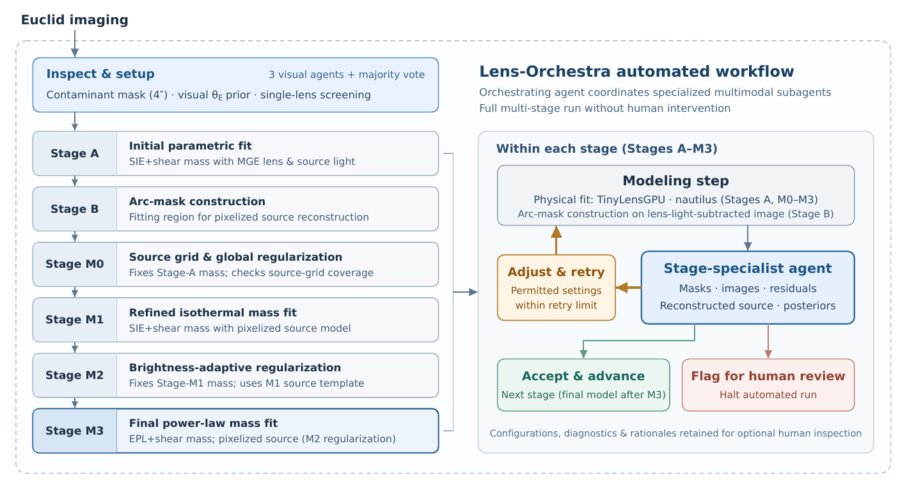
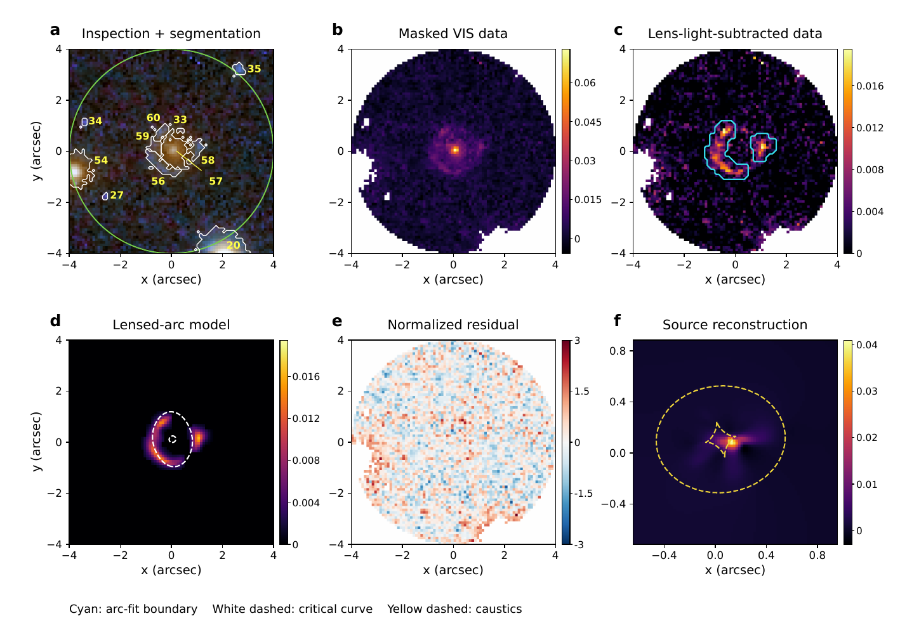

# Lens-Orchestra

> [!NOTE]
> The lens-model catalog and diagnostic plots for all **140 usable *Euclid* Q1 strong lenses** are available now in [`paper/`](paper/README.md). The full **Lens-Orchestra** codebase, agent specifications, and installation guide will be made publicly available in this repository upon acceptance of the paper.

**Lens-Orchestra** is an automated, multi-stage galaxy–galaxy strong gravitational lens modeling workflow that couples multimodal large language model (LLM) agents in [Codex CLI](https://developers.openai.com/codex/cli/) to GPU-accelerated physical forward modeling in [`TinyLensGpu`](https://github.com/caoxiaoyue/TinyLensGpu). Launched through natural-language instructions, it automates contaminant masking, visual Einstein-radius prior initialization, lens-light subtraction, arc-mask construction, and elliptical power-law (EPL+shear) mass modeling with pixelized source reconstruction—all without manual tuning. This repository accompanies *Toward Automated Strong-Lens Modeling with Agentic Workflows: An Application to Euclid Q1 Lenses* (Cao et al. 2026, in prep.).

Launching an end-to-end strong-lens modeling run requires only a single natural-language instruction in Codex CLI:

```text
$lens-model-orchestrator Perform automated strong-lens modeling on the Euclid Q1 system 102018666_NEG579859279508531437 in dataset/ using the euclid_lens_run Conda environment, and save the results under output/lens_run.
```

*Natural-language instructions work in any language and can target either a single lens or a full batch of systems. In addition to CLI runs, Lens-Orchestra also supports an interactive Web UI for human-in-the-loop inspection and refinement (see [Interactive Mode](#interactive-mode-web-ui) below).*



---

## Paper Results & Mass-Model Catalog

Tested without human intervention on 185 *Euclid* Quick Data Release (Q1) grade-A lens candidates with published mass models, Lens-Orchestra completed 149 automated multi-stage fits and halted 36 complex or problematic systems for human review. Independent human evaluation confirmed **140 usable EPL+shear mass models**—**126 Grade I** (fitted to the observational noise level) and **14 Grade II**—all of which are released in [`paper/`](paper/README.md):

- **[`paper/mass_model_catalog.csv`](paper/mass_model_catalog.csv)** — Final Stage-M3 EPL+shear mass-model posterior constraints ($\theta_{\rm E}$, $\gamma$, $e_1$, $e_2$, $\gamma_{{\rm ext},1}$, $\gamma_{{\rm ext},2}$) and human quality grades for all 140 usable lenses.
- **[`paper/result_figures/`](paper/result_figures/)** — Six-panel modeling summary figures (`<lens_id>.png`) for all 140 systems.
- **[`paper/README.md`](paper/README.md)** — Detailed guide to the catalog columns, physical parameterization, coordinate conventions, grading recommendations, quick-start Python snippet, and figure panels.


*Example end-to-end modeling products for a Euclid Q1 grade-I lens (`102019595_NEG630246532498667881`): (a) $`Y_{\rm E}/J_{\rm E}/\mathrm{VIS}`$ color composite with VIS segmentation contours and masked contaminants within the $`4''`$ aperture; (b) masked VIS data; (c) Stage-A lens-light-subtracted image with the Stage-B arc mask (cyan); (d) final Stage-M3 EPL+shear lensed-arc model with critical curves (white dashed); (e) normalized residuals; (f) reconstructed source on the pixelized grid with caustics (yellow dashed).*

---

## Interactive Mode (Web UI)

Beyond autonomous CLI runs for single lenses or large survey samples, **Lens-Orchestra** also provides an interactive Web UI (developed by Yunlong Yin) built on the same agent-driven modeling pipeline. Because every modeling stage preserves its intermediate products, settings, and diagnostic records, researchers can visually inspect masks, fits, and residuals in the browser, ask the agent in natural language to explain its configuration and diagnostic decisions, and instruct it to revise settings (such as contaminant or arc masks) before resuming downstream physical fits from that stage. This allows Lens-Orchestra to serve both as a hands-off survey pipeline and as an interactive co-scientist for complex lens systems.

https://github.com/user-attachments/assets/c3bf5a1d-f9b5-4650-8a69-59ac453f29e4

*Demo video (2 min 29 s): [Download MP4 (6.4 MB)](materials/videos/lens_orchestra_interactive_ui.mp4).*

---

## How the Modeling Pipeline Works

Instead of treating lens modeling as a black box, Lens-Orchestra decomposes each system into a transparent sequence of physical fits using `TinyLensGpu` and `nautilus` nested sampling. Specialized multimodal agents inspect the imaging, masks, residuals, source reconstructions, and posteriors at each step—advancing when diagnostics are clean, adjusting permitted modeling settings when a fixable issue appears, or halting for human review when a single-deflector model is inadequate.

| Step | Physical Modeling Task | What the Agents Inspect & Adjust |
| :--- | :--- | :--- |
| **Pre-modeling inspection** | $Y_{\rm E}/J_{\rm E}/\mathrm{VIS}$ color inspection and VIS segmentation within a $4''$ aperture | Three independent visual agents vote (2-of-3 majority) to mask unrelated contaminants, estimate an initial Einstein-radius prior $\theta_{\rm E}$, and flag multi-deflector or ambiguous systems. |
| **Stage A** | Initial joint parametric fit: SIE+shear mass + multi-Gaussian expansion (MGE) lens and source light | Checks primary multiple-image recovery and ensures deflector-light subtraction does not remove or distort lensed arcs. |
| **Stage B** | Arc-mask construction on the lens-light-subtracted image | Lowers S/N thresholds or expands the mask to capture faint counterimages, and removes unrelated residual emission. |
| **Stage M0** | Source-plane grid sizing and global pixelized-source regularization (Stage-A mass fixed) | Checks whether reconstructed source emission is clipped at the grid edge and expands the grid ($\pm 0.8'' \to \pm 1.0'' \to \pm 1.2''$) if needed. |
| **Stage M1** | Refined SIE+shear mass fit with a pixelized source | Rules out unphysical solutions (e.g., demagnified arc copies or noise-dominated reconstructions) and tunes sampler settings if convergence is poor. |
| **Stage M2** | Brightness-adaptive source regularization calibration (Stage-M1 mass fixed) | Widens regularization hyperparameter bounds if the posterior runs against a prior boundary. |
| **Stage M3** | Final EPL+shear mass fit with calibrated brightness-adaptive pixelized source | Verifies noise-level image residuals, compact source morphology, and posterior convergence; records any localized residuals for follow-up. |

---

## Citation

If you use this catalog, these modeling results, or **Lens-Orchestra** in your research, please cite our paper and the underlying [`TinyLensGpu`](https://github.com/caoxiaoyue/TinyLensGpu) modeling library:

```bibtex
@article{Cao2026LensOrchestra,
  author  = {{Cao}, Xiaoyue and {Li}, Ran and {Yin}, Yunlong and {Li}, Rui and {Gao}, Liang},
  title   = "{Toward Automated Strong-Lens Modeling with Agentic Workflows: An Application to Euclid Q1 Lenses}",
  journal = {in preparation},
  year    = {2026}
}
```

---

## License

This repository is released under the [MIT License](LICENSE).
