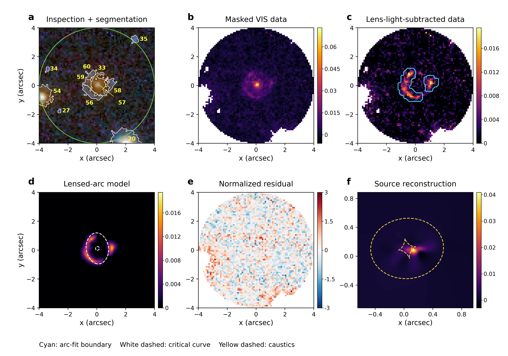

# Euclid Q1 Strong-Lens Modeling Results

This directory contains the published strong-lens modeling products for all **140 usable *Euclid* Quick Data Release (Q1) galaxy–galaxy strong lenses** analyzed with **Lens-Orchestra** in *Toward Automated Strong-Lens Modeling with Agentic Workflows: An Application to Euclid Q1 Lenses* (Cao et al. 2026, in prep.).

From the parent sample of 185 *Euclid* Q1 grade-A strong-lens candidates with published mass models, Lens-Orchestra completed 149 automated multi-stage fits without human intervention and halted 36 complex or problematic systems for human review. Independent human inspection confirmed **140 usable EPL+shear mass models**—**126 Grade I** and **14 Grade II**—which are released here (excluding the 9 Grade III unsuccessful fits).

## Directory Contents

- **[`mass_model_catalog.csv`](mass_model_catalog.csv)** — Summary catalog of final Stage-M3 EPL+shear mass-model posterior constraints for all 140 usable lenses.
- **[`result_figures/`](result_figures/)** — Six-panel modeling summary figures (`<lens_id>.png`) for all 140 systems, matching the `lens_id` entries in `mass_model_catalog.csv` one-to-one.

---

## Mass-Model Catalog (`mass_model_catalog.csv`)

Each row corresponds to one usable lens modeled on the *Euclid* VIS image ($`0.1''\,\mathrm{pixel}^{-1}`$) in **Stage M3** using an elliptical power-law (EPL) mass profile with external shear and a brightness-adaptive pixelized source reconstruction, sampled with `nautilus` nested sampling in `TinyLensGpu`.

For each physical parameter, the catalog reports the posterior **16th, 50th (median), and 84th percentiles** (`_q16`, `_q50`, `_q84`), defining the posterior median and $`68\%`$ credible interval.

### Column Descriptions

| Column(s) | Units | Description |
| :--- | :--- | :--- |
| `lens_id` | — | *Euclid* Q1 strong-lens identifier (matches `result_figures/<lens_id>.png` and the *Euclid* Q1 catalog). |
| `human_grade` | — | Independent human visual quality grade: `I` (126 lenses) or `II` (14 lenses); see grading guidelines below. |
| `theta_E_q16`, `theta_E_q50`, `theta_E_q84` | arcsec | Posterior 16th, 50th, and 84th percentiles of the **EPL mass-profile Einstein radius** $\theta_{\rm E}$ (see equation below). |
| `gamma_q16`, `gamma_q50`, `gamma_q84` | dimensionless | Posterior 16th, 50th, and 84th percentiles of the 3D logarithmic total mass-density slope $\gamma$ ($\rho \propto r^{-\gamma}$; isothermal corresponds to $\gamma = 2$). |
| `e1_mass_q16`, `e1_mass_q50`, `e1_mass_q84` | dimensionless | Posterior 16th, 50th, and 84th percentiles of the first Cartesian ellipticity component $e_1$ of the main deflector mass profile. |
| `e2_mass_q16`, `e2_mass_q50`, `e2_mass_q84` | dimensionless | Posterior 16th, 50th, and 84th percentiles of the second Cartesian ellipticity component $e_2$ of the main deflector mass profile. |
| `gamma1_q16`, `gamma1_q50`, `gamma1_q84` | dimensionless | Posterior 16th, 50th, and 84th percentiles of the first external shear component $\gamma_{{\rm ext},1}$. |
| `gamma2_q16`, `gamma2_q50`, `gamma2_q84` | dimensionless | Posterior 16th, 50th, and 84th percentiles of the second external shear component $\gamma_{{\rm ext},2}$. |

### Recommended Usage by `human_grade`

- **Grade `I` (126 lenses):** Lensed arcs and multiple images are reconstructed to the observational noise level. Suitable for both Einstein-radius ($\theta_{\rm E}$) and mass-density slope ($\gamma$) analyses.
- **Grade `II` (14 lenses):** The global multiple-image geometry and Einstein radius are reliably recovered, but localized image residuals remain that may bias the inferred radial density slope $\gamma$. Recommended for Einstein-radius and macro-geometry studies rather than density-slope inference.

### Physical Parameterization & Coordinate Conventions

All parameters are defined in the image cutout Cartesian frame $(x, y)$ with **$+x$ to the right**, **$+y$ upward**, and position angles $\phi$ measured **counter-clockwise from the $+x$ axis**:

1. **Elliptical Power-Law (EPL) convergence** (Tessore & Metcalf 2015): in coordinates $(x', y')$ centered on the main deflector and aligned with its principal axes,

   $`\kappa(R_\epsilon) = \frac{3 - \gamma}{2}\left(\frac{\theta_{\rm E}}{R_\epsilon}\right)^{\gamma - 1}, \qquad R_\epsilon = \sqrt{q\,x'^2 + y'^2/q}`$

   where $q \in (0, 1]$ is the minor-to-major axis ratio, $\gamma$ is the 3D logarithmic mass-density slope, and $\theta_{\rm E}$ is the EPL profile Einstein radius reported in `theta_E_*`. *(Note: $`\theta_{\rm E}`$ here is the EPL profile parameter itself, distinct from the critical-curve-area effective Einstein radius $`\theta_{\rm E,eff} = \sqrt{A_{\rm t}/\pi}`$ used for cross-pipeline comparison against the Q1 SIE+shear models in the paper.)*

2. **Ellipticity components** (`e1_mass`, `e2_mass`):

   $`(e_1, e_2) = \frac{1 - q}{1 + q}(\cos 2\phi,\; \sin 2\phi)`$

   From $(e_1, e_2)$, the axis ratio and major-axis position angle are recovered via:

   $`e = \sqrt{e_1^2 + e_2^2}, \qquad q = \frac{1 - e}{1 + e}, \qquad \phi = \frac{1}{2}\mathrm{atan2}(e_2, e_1) \bmod \pi`$

3. **External shear** (`gamma1`, `gamma2`): defined by the lensing potential

   $`\psi_{\rm ext}(x, y) = \frac{1}{2}\gamma_{{\rm ext},1}(x^2 - y^2) + \gamma_{{\rm ext},2}\,xy`$

   with shear amplitude $\gamma_{\rm ext} = \sqrt{\gamma_{{\rm ext},1}^2 + \gamma_{{\rm ext},2}^2}$ and orientation $\phi_{\rm ext} = \tfrac{1}{2}\mathrm{atan2}(\gamma_{{\rm ext},2}, \gamma_{{\rm ext},1}) \bmod \pi$.

### Quick Python Example

```python
import numpy as np
import pandas as pd

cat = pd.read_csv("mass_model_catalog.csv")

# Select the 126 Grade-I lenses (recommended for density-slope studies)
grade1 = cat[cat["human_grade"] == "I"].copy()

# Asymmetric 68% credible-interval half-widths for the EPL Einstein radius
theta_e_med = grade1["theta_E_q50"]
theta_e_err_low = grade1["theta_E_q50"] - grade1["theta_E_q16"]
theta_e_err_high = grade1["theta_E_q84"] - grade1["theta_E_q50"]

# Convert posterior-median (e1, e2) to axis ratio q and position angle phi (deg)
e = np.hypot(grade1["e1_mass_q50"], grade1["e2_mass_q50"])
q = (1.0 - e) / (1.0 + e)
phi_deg = (0.5 * np.degrees(np.arctan2(grade1["e2_mass_q50"], grade1["e1_mass_q50"]))) % 180.0
```

---

## Modeling Summary Figures (`result_figures/`)

Each file `result_figures/<lens_id>.png` presents a six-panel summary of the end-to-end automated modeling for that system, using the same layout as Figure 2 of the paper:



- **(a) Inspection + segmentation:** $Y_{\rm E}/J_{\rm E}/\mathrm{VIS}$ color composite with VIS $3\sigma$ segmentation contours (white) and segment IDs (yellow) overlaid. The green circle marks the $4''$-radius modeling aperture used by the visual-inspection agents to identify and mask unrelated contaminants.
- **(b) Masked VIS data:** Observed *Euclid* VIS cutout after masking agent-selected contaminant segments and pixels outside the $4''$ aperture (masked regions shown in white).
- **(c) Lens-light-subtracted data:** VIS image after subtracting the Stage-A multi-Gaussian expansion (MGE) deflector-light model. Cyan contours outline the Stage-B arc mask defining the image-plane fitting region for pixelized-source modeling (Stages M0–M3).
- **(d) Lensed-arc model:** Best-fit lensed-source reconstruction from the final Stage-M3 EPL+shear model, overlaid with the critical curves (white dashed lines).
- **(e) Normalized residual:** Standardized image residuals `(data - model) / sigma` across the modeling aperture (displayed from $-3\sigma$ to $+3\sigma$).
- **(f) Source reconstruction:** Reconstructed background source surface brightness on the pixelized source grid ($`0.02''\,\mathrm{pixel}^{-1}`$), overlaid with the caustics (yellow dashed lines).

---

## Data Provenance & Citation

The underlying *Euclid* Q1 strong-lens imaging cutouts and parent lens catalog are publicly available from the *Euclid* Collaboration Q1 Strong Lensing Discovery Engine release (Walmsley et al. 2026; Zenodo: [`10.5281/zenodo.15025832`](https://doi.org/10.5281/zenodo.15025832)).

For code usage, installation, and interactive workflows, see the main repository [`README.md`](../README.md). If you use this catalog or these modeling results in your work, please cite:

```bibtex
@article{Cao2026LensOrchestra,
  author  = {{Cao}, Xiaoyue and {Li}, Ran and {Yin}, Yunlong and {Li}, Rui and {Gao}, Liang},
  title   = "{Toward Automated Strong-Lens Modeling with Agentic Workflows: An Application to Euclid Q1 Lenses}",
  journal = {in preparation},
  year    = {2026}
}
```
